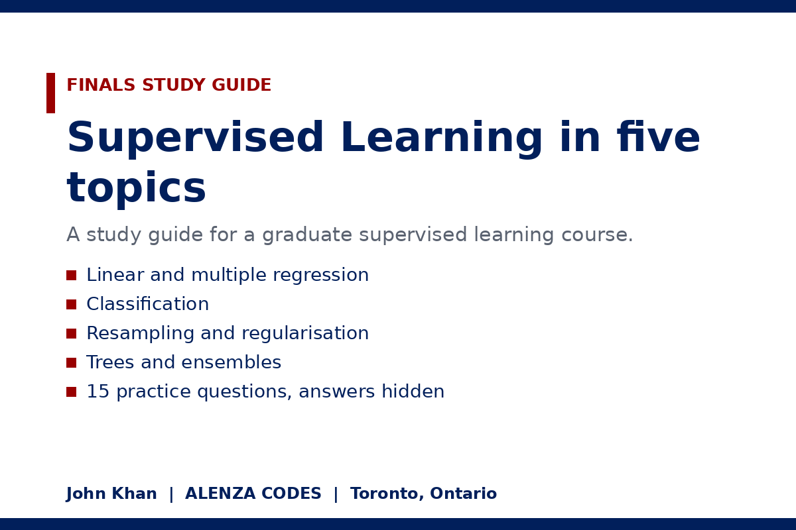
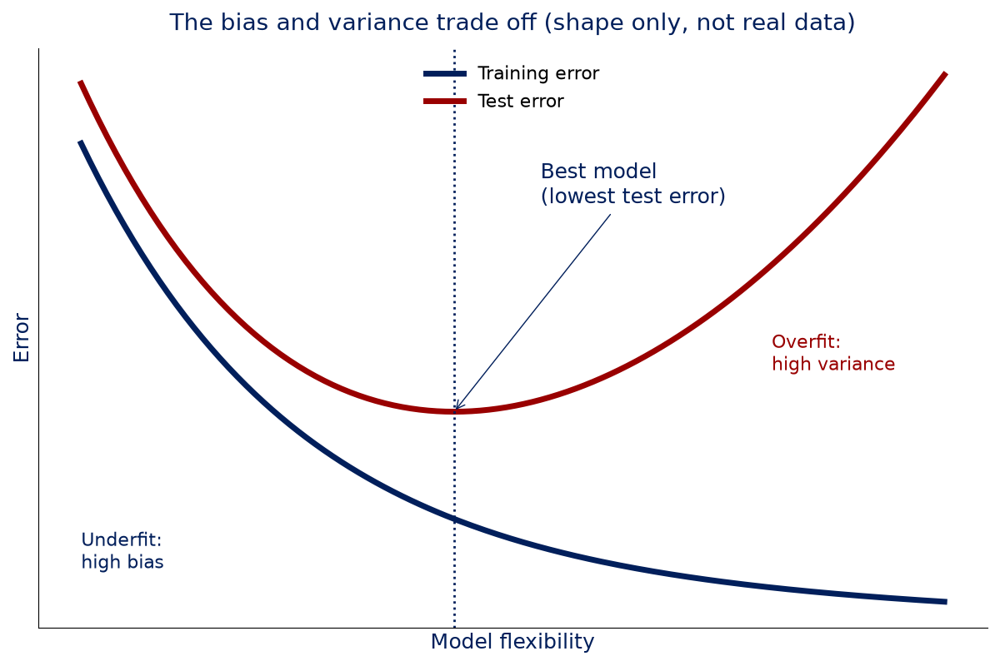

# Supervised Learning Finals Study Guide

A finals study guide for a graduate supervised learning course, built in Gamma from my notes. One card per exam topic, each ending with practice questions and their worked answers.



Gamma view link: added after publishing

## Topics
1. Supervised learning and simple linear regression
2. Multiple linear regression for prediction and inference
3. Classification: logistic regression, discriminant analysis and KNN
4. Model evaluation, resampling and regularisation
5. Tree based methods and ensembles

Plus a cheat sheet card and a bias and variance diagram.



## Project structure

```text
supervised-learning-study-guide/
├── images/
│   └── bias-variance-diagram.png  # The diagram card (shape only, not real data)
├── cover.png                      # Cover image
├── README.md                      # This file
└── study-guide.md                 # The full guide imported into Gamma, with 15 practice questions and answers
```

Built by John Khan, ALENZA CODES, Toronto, Ontario.
